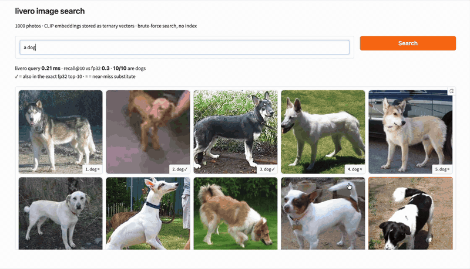

# livero

**English** | [한국어](README.ko.md)

livero is a small vector database built for the on-device ecosystem.
It is written in pure C, uses a fixed 48KiB of RAM, and searches by brute-force scan with no index.

<p align="center">
  
</p>

<p align="center">
  <sub>Searching 1,000 cat and dog photos with CLIP embeddings. ✓ means the result matches an fp32 brute-force search.</sub>
</p>

---

- [livero](#livero-1)
- [Search quality](#search-quality)
- [Benchmarks](#benchmarks)
- [Capacity](#capacity)
- [Build](#build)
- [Usage](#usage)
- [Design](#design)
- [Limitations](#limitations)
- [Roadmap](#roadmap)

---

## livero

In the on-device environments livero targets, datasets are small: thousands to tens of thousands of records.
At this scale, livero chooses a simple, predictable brute-force scan over a complex ANN index.

- **No index**: no graph or clusters to keep in memory. Query time grows linearly with data size, and search quality does not depend on data distribution or tuning parameters.
- **Fixed memory**: uses only 48KiB, with no dynamic allocation at runtime.
- **Ternary quantization**: vectors are stored as {-1, 0, +1}. A 384-dim fp32 vector (1,536B) becomes 96B, so there is 16x less data to read.
- **popcount-based dot product**: inner products are computed with bitwise operations and popcount only, without multiplication.

In a preliminary experiment, dot products over 1M 768-dim ternary vectors took 6ms with scalar C code (in memory, compute only). From this, I concluded that computation would not be the bottleneck.

## Search quality

How much search quality survives ternary quantization?
recall@10 on 10,000 AG News documents with 500 queries, using fp32 brute-force results as ground truth.

| Embedding model | Dim | recall@10 |
|---|---|---|
| all-MiniLM-L6-v2 | 384 | 0.7684 |
| bge-base-en-v1.5 | 768 | 0.7878 |

Experiment code: [`tests/python/recall_experiment.py`](tests/python/recall_test.py)

## Benchmarks

Results are currently from a Mac and an LG Gram laptop only.
Experiments on more constrained on-device environments (mobile, SBC, MCU) are in progress.

**Conditions**: Release build, 384 dims, 487B values, top-k 10, 100 samples each for GET/QUERY

### Mac (Apple M5)

| Records | PUT avg / p50 / p99 | GET avg / p50 / p99 | QUERY avg / p50 / p99 |
|---|---|---|---|
| 1,000 | 0.102 ms / 0.090 ms / 0.221 ms | 0.003 ms / 0.003 ms / 0.004 ms | 0.028 ms / 0.028 ms / 0.044 ms |
| 10,000 | 0.074 ms / 0.073 ms / 0.098 ms | 0.004 ms / 0.004 ms / 0.011 ms | 0.097 ms / 0.095 ms / 0.152 ms |
| 100,000 | 0.082 ms / 0.081 ms / 0.117 ms | 0.006 ms / 0.006 ms / 0.011 ms | 0.713 ms / 0.696 ms / 1.338 ms |

### LG Gram (Intel i7-1260P, Fedora)

On x86-64, `-mpopcnt` is enabled by default (disable with `-DLV_ENABLE_POPCNT=OFF`).

| Records | PUT avg / p50 / p99 | GET avg / p50 / p99 | QUERY avg / p50 / p99 |
|---|---|---|---|
| 1,000 | 6.631 ms / 6.606 ms / 10.786 ms | 0.011 ms / 0.012 ms / 0.028 ms | 0.099 ms / 0.095 ms / 0.274 ms |
| 10,000 | 6.910 ms / 6.781 ms / 10.913 ms | 0.010 ms / 0.012 ms / 0.028 ms | 0.262 ms / 0.249 ms / 0.582 ms |
| 100,000 | 6.789 ms / 6.672 ms / 10.809 ms | 0.007 ms / 0.007 ms / 0.015 ms | 1.897 ms / 1.739 ms / 2.989 ms |

**Why PUT differs so much between the two**: livero opens every file with `O_SYNC`. On Linux, `O_SYNC` actually writes through to the storage device, so a single PUT takes about 6.7ms. On macOS, `O_SYNC` does not flush the drive's cache (that requires `F_FULLFSYNC`), so it measures much faster. The Mac PUT numbers therefore do not represent the same durability as Linux.

Benchmark code: [`tests/benchmark.c`](tests/benchmark.c)

## Capacity

PUT until a fixed maximum disk size is full (fp32 input, 4MiB).
Per-record metadata is a constant 23B.

| Dim | Value length | Records stored | Bytes per record | Disk utilization |
|---|---|---|---|---|
| 128 | 1B | 74,897 | 56.0 B | 100.0% |
| 384 | 1B | 34,952 | 120.0 B | 100.0% |
| 768 | 1B | 19,417 | 216.0 B | 100.0% |
| 384 | 100B | 19,151 | 219.0 B | 100.0% |
| 384 | 1–487B (random) | 11,567 | 362.6 B | 99.99% |
| 768 | 1–487B (random) | 9,155 | 458.1 B | 99.99% |

The record count after reopening matched in every case.

Experiment code: [`tests/python/capacity_experiment.py`](tests/python/capacity_test.py)

## Build

Requires a C23-capable compiler and CMake.

```bash
cmake -S . -B build-release -DCMAKE_BUILD_TYPE=Release
cmake --build build-release
ctest --test-dir build-release
```

If `CMAKE_BUILD_TYPE` is not set, you get a Debug build with AddressSanitizer enabled. Always use Release when measuring performance.

On x86-64, livero is built with `-mpopcnt` to use the hardware `POPCNT` instruction. Without it, queries are about 2.5x slower.

## Usage

### C

```c
#include <sys/stat.h>
#include "livero.h"

int main(void) {
    // The directory must exist before lv_create.
    mkdir("./my_db", 0755);

    const LVConfig config = {
        .max_disk_bytes   = 4 << 20,              // 4 MiB
        .vector_type      = LV_VEC_TYPE_FP32,
        .vector_dimension = 384,
    };

    Livero* db = NULL;
    if (lv_create("./my_db", &config, &db) != LV_OK) return 1;

    float vector[384] = { /* embedding */ };
    const LVDate date = { .year = 2026, .month = 10, .day = 15 };
    const char* value = "hello";
    LVSeq_t key;
    lv_put(db, vector, &date, (const uint8_t*)value, 5, &key);

    // Top-10 search. Pass NULL dates to search all records.
    LVQueryResult* results = NULL;
    LVSize_t count = 0;
    lv_query(db, 10, vector, NULL, NULL, &results, &count);

    lv_close(db);
    return 0;
}
```

### Python

A cffi binding is provided.

```bash
pip install cffi
python tests/python/build.py
```

```python
# Run in tests/python
from livero import Livero, LVStatus, LVVectorType, LVDate

db = Livero()
db.create("./my_db", {
    "max_disk_bytes": 4 << 20,
    "vector_type": LVVectorType.LV_VEC_TYPE_FP32,
    "vector_dimension": 384,
})

status, key = db.put(vector, LVDate(2026, 10, 15, 0, 0, 0), b"hello")
status, results = db.query(vector, 10, None, None)
for r in results:
    print(r.key, r.date, r.value)

db.close()
```

### API

| Function | Description |
|---|---|
| `lv_create` | Create a new database. |
| `lv_open` | Open an existing database. |
| `lv_put` | Store a vector, date, and value; returns the key. |
| `lv_get` | Read the date and value for a key. |
| `lv_delete` | Delete the record for a key (tombstone). |
| `lv_query` | Top-k search, with an optional date range filter. |
| `lv_db_info` | Return the config, record count, and file sizes. |
| `lv_close` | Close the database. |

- Max top-k: 64 (`LV_MAX_K`)
- Max value length: 487B (`LV_MAX_VALUE_LEN`)
- Max vector dimension: 768 (`LV_MAX_VECTOR_DIMENSION`)
- Input vector types: `fp32`, `int8` (quantized to ternary on write)

### Tests

`ctest` verifies:

- PUT/GET round trip
- Data and key continuity after reopening
- GET fails after delete
- Query results match brute-force ground truth
- Date filter boundaries (inclusive bounds, ranges with zero results)
- Deleted records are excluded from query results

## Design

### Memory (48KiB)

| Region | Size |
|---|---|
| Query result buffer | 504B × 64 = 31.5KiB |
| File batch buffer | 16KiB |
| `Livero` struct | 64B |
| Free space | 448B |
| Total | 48KiB |

No additional memory is allocated at runtime.

### Files

livero manages data with three files. All of them are append-only.

- `val_log.lv`: raw values, up to 487B each.
- `vec_log.lv`: quantized vectors.
- `db.lv`: database state (disk usage, metadata for each file), plus key, date, value_len, and val_log_offset for each record.

Writes go `val_log.lv` → `vec_log.lv` → `db.lv`, and the `db.lv` header is written last. Writing the header is the commit point: if power is lost midway, only the range the header points to is treated as valid.

### Keys

A key in livero is a seq value that increases in insertion order.
Custom keys are not supported, but in exchange, records have a fixed size and keys are guaranteed to be sorted without a separate index. GET uses this ordering to find records by binary search.

### Query

1. Quantize the query vector to ternary (BitNet b1.58 absmean method).
2. Read `vec_log.lv` 16KiB at a time and compute the dot product with each vector.
3. Keep the top k in a min-heap of size k. If the heap is full and the dot product is not greater than the heap minimum, skip immediately.
4. Only candidates that would enter the heap are checked against `db.lv` for date and deletion. As the scan goes on, the heap minimum rises, so only a small fraction of records is actually checked.

### Ternary dot product

Each vector is stored as two bit planes: a mask bit (non-zero?) and a sign bit (negative?).

```
M   = mask_a & mask_b
X   = (sign_a ^ sign_b) & M
dot = popcount(M) - 2 * popcount(X)
```

## Limitations

- Single process, single thread only.
- No record updates.
- Deletes are tombstones; deleted space is not reclaimed.
- File offsets are 4B, so a single file cannot exceed 4GiB.
- No custom keys.
- On macOS, `O_SYNC` does not flush the drive cache, so durability is not equivalent to Linux.

## Roadmap

- The dot product currently uses `__builtin_popcountll`. SIMD kernels are planned.
- Files are opened with `O_SYNC` for durability, so on Linux a single PUT takes about 6.7ms. The plan is to let users choose the durability level and use an internal cache.
